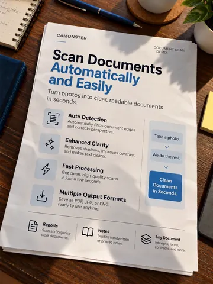
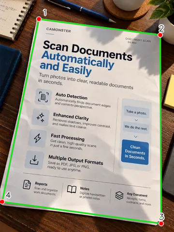
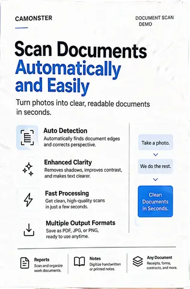

# Aster — Document Corner Detection

## 安裝

```bash
cd Aster
python3 -m venv .venv
source .venv/bin/activate
python -m pip install -r requirements.txt
```


## 訓練

GPU
```bash
python -m aster train
```
CPU

```bash
python -m aster train --set train.device=cpu
```

## 評估

```bash
python -m aster evaluate --model weights/Aster.pt --data data/real_test --vis export/preview
```

## 匯出

```bash
python -m aster export --model weights/Aster.pt --out export/Aster.onnx --mnn export/Aster.mnn
```


<h2>四角標記示範</h2>

<p align="center">
  
  
</p>

<h2>Aster 模型應用於 Camonster 文件攤平效果 <a href="https://www.camonster.online/scan/">https://www.camonster.online/scan/</a></h2>

<p align="center">
  
</p>


